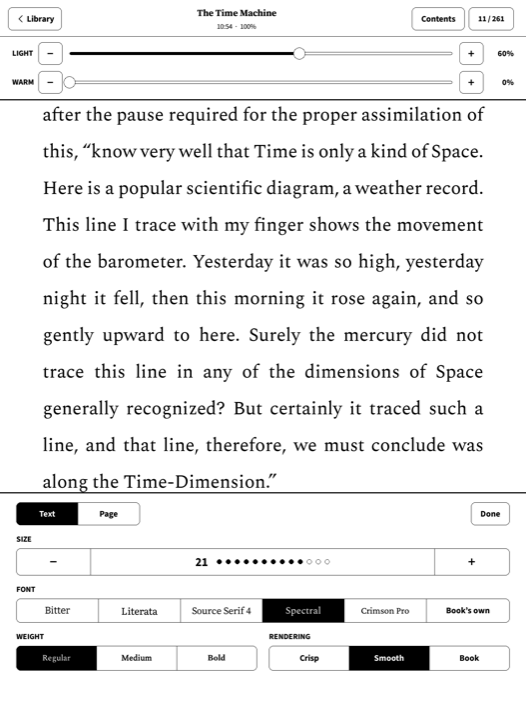
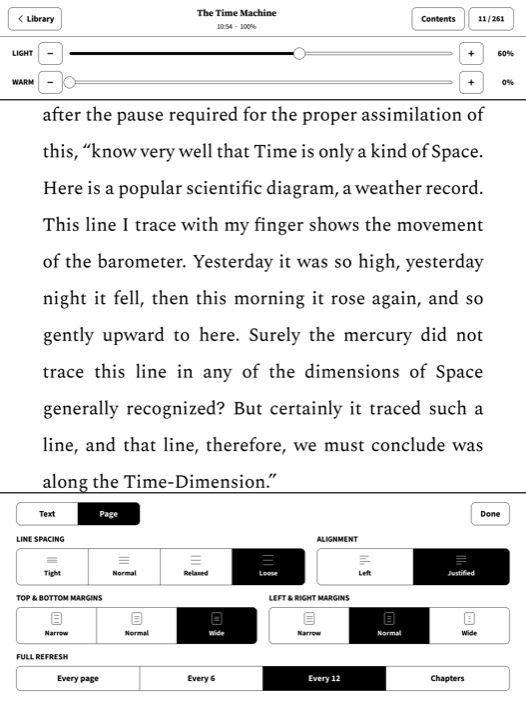
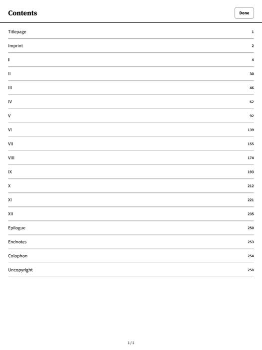

# Calm UI for KOReader

A radically simplified interface for [KOReader](https://koreader.rocks) on Kobo e-readers. It has two screens, a library and a reader, with every setting you need in one sheet. There are no menus, status bars or hidden gestures to learn.

KOReader still does the work underneath, including its book rendering, dictionary, sync and statistics. Calm UI is a KOReader plugin plus a few small patches, not a fork. It removes KOReader's own interface instead of covering it up.

<p>
  
  
  
</p>

## What you get

**The library** opens when KOReader starts. It shows your books as covers or a list, sorted by recent, title or author, with search at the top. Touch and hold a book for its details, Mark finished and Delete. **Back to Kobo** returns to the Kobo's own home screen.

**The reader** shows the page and its number, and nothing else. Swipe or use the page buttons to turn pages. Tap anywhere to open the sheet:

- **Top strip:** Library, the book's title with the time and battery, Contents, and the page number, which you tap to go to a page.
- **Light and warmth:** sliders with − and + buttons. You can also drag up or down along the left edge of the screen for brightness, or the right edge for warmth, without opening the sheet.
- **Text:** size, font, weight and rendering.
- **Page:** line spacing, alignment, margins and how often the screen fully refreshes.

PDFs get their own sheet with Fit, Contrast and Full refresh.

**The cogwheel** in the library header has the rest: Wi-Fi, sleep timing, reading statistics, calibre wireless and KOReader sync.

<p>
  
  
  
  
</p>

## Requirements

- **KOReader**, installed on the Kobo with a way to open it, such as NickelMenu. KOReader's [Kobo installation guide](https://github.com/koreader/koreader/wiki/Installation-on-Kobo-devices) covers this.
- **The right KOReader version:** nightly [`v2026.07.2-293-gc8eb592`](https://github.com/koreader/koreader/releases/download/ota/koreader-kobo-v2026.07.2-293-gc8eb592_2026-10-27.targz). Calm UI changes parts of KOReader's interface directly, so a different version may not work.
- **A Kobo with firmware 4.x.** Calm UI has been tested on the Kobo Elipsa 2E and Kobo Libra 2, both on firmware 4.38. Its layout follows the screen's size and density, so other Kobos should work but haven't been tried.

## Install

1. Download `update.tar.xz` from the [latest release](../../releases/latest).
2. Connect the Kobo to your computer and tap **Connect** on the Kobo's screen.
3. Copy `update.tar.xz` into `.adds/koreader/ota` on the Kobo. Keep its name.
4. Eject the Kobo and open KOReader.

KOReader unpacks Calm UI as it starts. You'll briefly see "Updating KOReader" and "Update successful", which is KOReader's own installer at work, and then the library.

If KOReader was already open when you connected the Kobo, Calm UI only unpacks at KOReader's next start, so close KOReader and open it again. Once Calm UI is installed, it does this restart for you.

The `.adds` folder is hidden. On a Mac, press **Cmd + Shift + .** in Finder to show it. On Windows, choose **View → Show → Hidden items** in File Explorer.

> [!WARNING]
> Copy only the file. Never drag a whole folder such as `.adds` from your computer onto the Kobo: your computer may replace the Kobo's folder and everything in it.

> [!NOTE]
> Why one file? Calm UI is many small files. Copied one by one from a computer, a file can occasionally be renamed by the Kobo's disk check when you unplug it, and Calm UI then fails to load. In one package, KOReader unpacks the files on the Kobo itself.

**On a Mac**, you can install from a copy of this repository instead. Connect the Kobo, tap **Connect**, and run:

```bash
git clone https://github.com/embergabor/koreader-calmui.git
```

```bash
cd koreader-calmui && ./deploy-to-kobo.sh
```

On a Kobo without KOReader, this also sets up KOReader at the version above, and NickelMenu to open it. Afterwards, connect the Kobo again and run `./deploy-to-kobo.sh --check` to confirm that everything arrived.

## Optional extras

**Fonts.** The Text tab always offers Source Serif 4, which comes with KOReader, and **Book's own**, which uses the book's embedded fonts. It also shows a button for each of these fonts once it's installed: [Bitter](https://fonts.google.com/specimen/Bitter), [Literata](https://fonts.google.com/specimen/Literata), [IBM Plex Serif](https://fonts.google.com/specimen/IBM+Plex+Serif), [Spectral](https://fonts.google.com/specimen/Spectral) and [Crimson Pro](https://fonts.google.com/specimen/Crimson+Pro). They're free from Google Fonts. Copy their `.ttf` files into the `fonts` folder at the top of the Kobo, creating it if needed.

**Dictionary.** Touch and hold a word to look it up. Calm UI hides KOReader's dictionary downloader, so add one by hand. For English, download the [English-English Wiktionary](https://github.com/Vuizur/Wiktionary-Dictionaries/raw/master/English-English%20Wiktionary%20dictionary%20stardict.tar.gz), unpack it, and copy what it contains into a new folder inside `.adds/koreader/data/dict`. Any StarDict dictionary works the same way.

**Rare options.** Anything not on screen, such as the library's columns, the edge gestures and which fonts the Text tab offers, is in `.adds/koreader/plugins/quietui.koplugin/settings.lua`. Edit it over USB and restart KOReader. Installing an update replaces this file, so keep a copy of any changes.

## Updating

Install a newer `update.tar.xz` the same way as the first time. Your books, reading positions and settings stay as they are.

## Uninstalling

1. Delete `.adds/koreader/plugins/quietui.koplugin`.
2. In `.adds/koreader/patches`, delete the four files whose names contain `quietui`.
3. Open KOReader. Its usual interface is back. Calm UI switched off the KOReader plugins it didn't use, so to turn them back on, go to **Tools → More tools → Plugin management**.

Calm UI also replaced KOReader's USB connection screen with a quieter one. Reinstalling or updating KOReader brings the original back.

## Questions

**Does it change my books?** No. Books, reading positions, highlights and KOReader's settings stay in the same places.

**Can I still reach KOReader's own menus?** Not by default. For a one-off job, set `hold_top_left = "menu"` in `settings.lua`; touching and holding the top-left corner of a book then opens them. Set it back to `"none"` afterwards.

**Sync between devices?** Log in to KOReader sync from the cogwheel. Your reading position then moves forward on its own when you open a book on another device, and never moves backward.

## For developers

```
mods/plugins/quietui.koplugin   the plugin (the internal name is still quietui)
mods/patches                    KOReader user patches, applied at startup
mods/usbms                      the quieter USB connection screen
tools/make-package.sh           builds update.tar.xz
deploy-to-kobo.sh               installs over USB; --check verifies; --wifi installs over Wi-Fi
GOALS.md                        the design goals and every decision so far
```

To build a release package:

```bash
tools/make-package.sh dist/update.tar.xz
```

**Updates over Wi-Fi.** A Kobo that was set up with `deploy-to-kobo.sh` has an extra **Updates over Wi-Fi** row in the cogwheel. Turn it on, and `./deploy-to-kobo.sh --wifi <address>` installs from your Mac without a cable, then restarts KOReader. It logs in with a key that only your Mac has, and it turns off again when the Kobo sleeps.

Development uses the macOS KOReader emulator and a KOReader source checkout at the same version. Neither is in this repository. `run-emulator.sh` expects them in `emulator/` and `src/`, and `--libra` emulates the Libra 2's screen.
